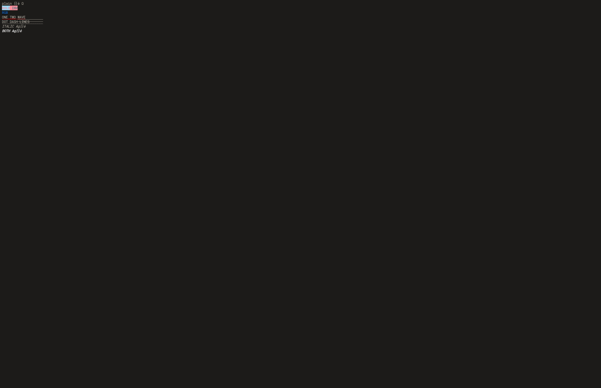

# Terminal synthetic font variants

SGR bold and italic now select cached font variants in the native terminal
renderer. Previously bold changed foreground color while all cells used the
regular glyph shape. Regular, bold, italic and bold/italic now have separate
FreeType faces and atlases, with the existing SDL3 geometry batcher drawing them.

A shared base `RenFont` owns at most three lazy variants. Each variant borrows
the base font-file bytes and owns its faces/atlases; no font-file copy is made
per variant or pane. A base is still the only owning Lua font object and the
only font pointer held in deferred row commands. Teardown frees variant faces
and atlases before the base's bytes. Variant allocation or face failure leaves
the base intact and is reported before native rows are queued.

Advances, cell size, baseline and height remain stable across synthetic styles.
Cached row damage now includes actual glyph ink extents, including italic
overhang, fallback glyph height and font decorations. Tab changes propagate to
variants, including a reset to zero. `terminal.ITALIC` exposes the existing style
bit for inspection.

## Verification

- Full normal CTest: **145/145**, 140.18s.
- Normal focused font/native/Unicode/Studio checkpoint: **9/9**, 3.08s.
- ASan/UBSan font and Studio checkpoint: **5/5**, 2.79s; final font/pixel tests
  after decoration-bound changes: **2/2**, 2.60s.
- Final real SDL3 windows: styled reference pixels, shell input/final output
  and Vim's exact saved text all pass.
- Strict C11 checks on the changed row/binding modules and diff checks pass.

`tests/c/renderer_fonts.c` uses the real FreeType renderer with allocation and
face-failure hooks. It proves variant pointer reuse, shared byte identity,
distinct style atlas pixels, stable advances including fallback/wide/combining
text, per-glyph ink containment, decoration bounds, failed row preparation and
destruction of the base with live variants. The initial red build failed on the
missing variant/bounds APIs, then passed with their implementation.

`studio_terminal_render` keeps the saved historical Lua renderer unchanged.
Its test oracle uses independently loaded synthetic style fonts through the
old cell calls. Exact backbuffer comparisons cover all four styles, colors and
decorations, regular transitions, clips, overflowing glyph changes, history,
reflow and alternate screens. A queued bold/italic row survives explicit base
font finalization, with destruction deferred until replay finishes.

## Controlled draw measurements

macOS arm64, SDL3 3.4.14 dummy driver, 80×24 pane, explicit font size 16, normal
build. Three independently warmed processes per frontend, 21 samples per case,
alternating process order, with every process completed before the next starts.
Both frontends use the same final C binary. The reference uses the saved Lua
cell renderer with style-aware font selection and independent option fonts;
native rendering uses base-owned variants. This compares matching style behavior.
Compiled renderer source hashes and font-file hashes are recorded and checked.

Feed and `sync` are outside the timed draw. These are warmed pane draw costs,
including capture/replay, not key-to-pixel latency or full application throughput.
The changed font size and style oracle make this a separate experiment from the
earlier native-row report; the old reports are unchanged.

| Corpus | State | Lua style oracle CPU median | Native CPU median |
| --- | --- | ---: | ---: |
| Plain | Unchanged | 1.054 ms | 0.008 ms |
| RGB/256 colors | Unchanged | 1.477 ms | 0.008 ms |
| Unicode | Unchanged | 0.833 ms | 0.007 ms |
| Mixed styles (three effective styles) | Unchanged | 1.135 ms | 0.007 ms |
| Plain | One row changes | 1.893 ms | 0.946 ms |
| RGB/256 colors | One row changes | 2.445 ms | 1.139 ms |
| Unicode | One row changes | 1.622 ms | 1.014 ms |
| Mixed styles (three effective styles) | One row changes | 2.563 ms | 2.088 ms |

Native frames issue zero Lua text calls and capture zero/one rows on unchanged/
dirty frames. Raw CPU/wall samples and manifests are in
[`2026-10-14-font-variant-raw`](2026-10-14-font-variant-raw/).

Alternating style textures make dirty replay materially more expensive than
plain text. The current rencache replay still visits all terminal rows for each
dirty region. Skipping rows whose complete ink bounds miss that region is the
next concrete renderer optimization to verify; merged style atlases and any
hardware-instancing choice still need their own evidence.

BMUX-24 and BMUX-25 remain open. This implements synthetic outline styles,
not real style-face discovery or complex shaping. Bitmap/color emoji behavior,
optional ligatures, procedural box/block/powerline glyphs, HiDPI/zoom,
terminal/render Unicode-profile agreement and non-macOS execution remain
required work in their respective tickets.

Correction discovered during the subsequent shared-atlas work: this experiment's
mixed corpus used SGR 3 without clearing bold, so its italic segment was also
bold. It exercised regular, bold and bold/italic. The all-four-style pixel/font
tests were independent and valid. Raw historical timing records are preserved;
the later benchmark clears bold and records corpus hashes.
