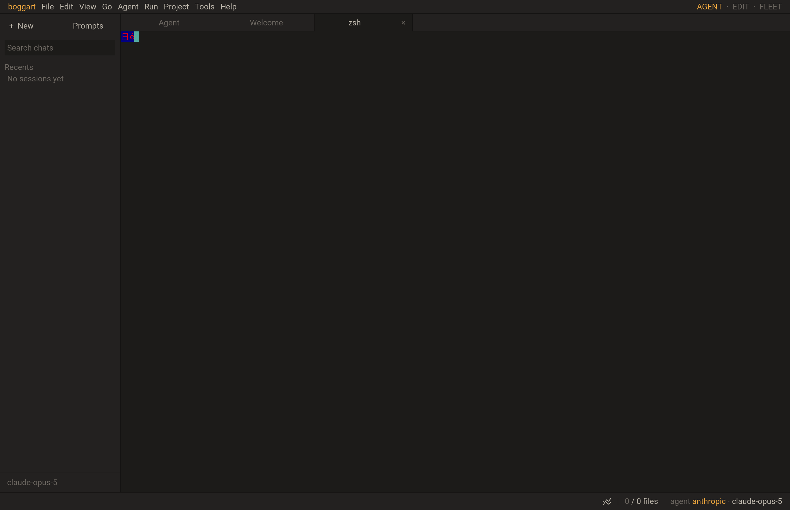
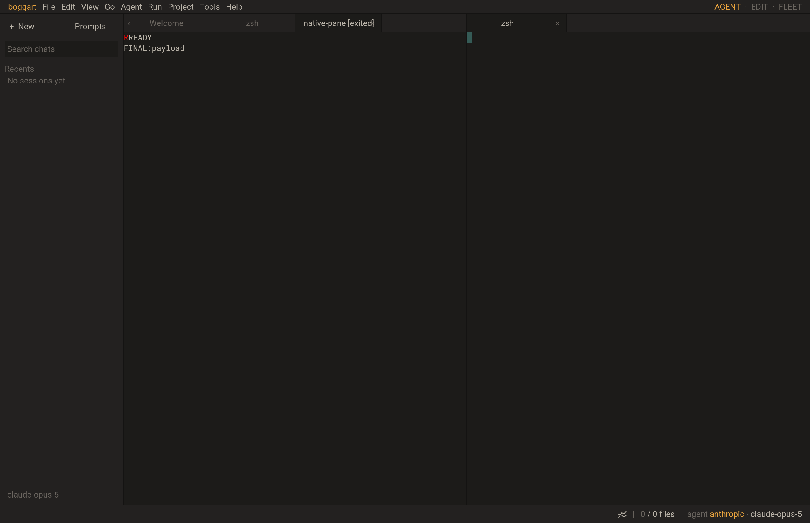

# Native Studio terminal integration evidence

This is integration/verification evidence, not a performance measurement.
Execution is macOS arm64 with pinned SDL3 3.4.14, C11 and Lua 5.5.

Studio uses `terminal.open` through `src/bpty.c`, and child bytes feed the C VT
core directly. No production Lua byte parser, KEY_SEQ, manual Ctrl-letter
encoder or per-frame PTY read/reap remains. One SDL waiter monitors the Unix
libuv backend; main-thread dispatch owns all C parsing and Lua callbacks.
The standalone waiter test verifies parked idle/empty loops, coalescing, timer
and I/O wakeups, main-thread callbacks and joined teardown.

`studio_terminal_native` injects actual SDL queue events through the existing
test-script entry point. It covers text/IME deduplication, Ctrl-C, application
cursor keys, Kitty modifiers/release, negotiated paste and mouse/wheel input,
focus, pane shortcuts, native colors/wide clusters/alternate-screen and a real
shell's complete final output. The shell is driven only by Studio's central
pump/wait, with no test-side uv.run or Lua output feed.

`studio_terminal_vim` runs `/usr/bin/vim -Nu NONE -n -i NONE` on a task-owned
file. SDL events enter insert mode, insert HELLO_, escape and save/quit. The
native alternate-screen transitions, displayed text, exact resulting file
contents and exit status are checked. Shell and Vim tests also pass with real
SDL windows; fixtures normalize macOS Command/Option names and point/pixel
coordinates without changing the product's event normalization.

The packaged @assets path now lists embedded plugin directories, preserving
pane shortcuts when no disk data tree exists. Normal quit reaches C cleanup;
a retained live child and blocked waiter are tested through that path.

Final normal full CTest passes 141/141 (142.36s). Final focused ASan/UBSan
passes eleven tests (22.00s); the separately registered Vim sanitizer test also
passes. Both products build and strict C11 checks pass. The legacy Lua parser
reference has exact origin revision/SHA recorded in
`tools/termbench/reference/terminalview-v1.json` and is hash-guarded by termbench.
Historical benchmark reports retain their original source identity and meaning.

At this earlier checkpoint rendering used Lua visible-cell draw calls over SDL.
The subsequent [native row renderer checkpoint](2026-10-14-native-row-renderer.md)
replaces those calls. Shaping/font-profile alignment, selection, links and search
remain Phase 2.
Windows ConPTY, non-macOS execution, broad TUI conformance and application
throughput/RSS/100-pane idle/key-to-pixel budgets remain unproven here.
