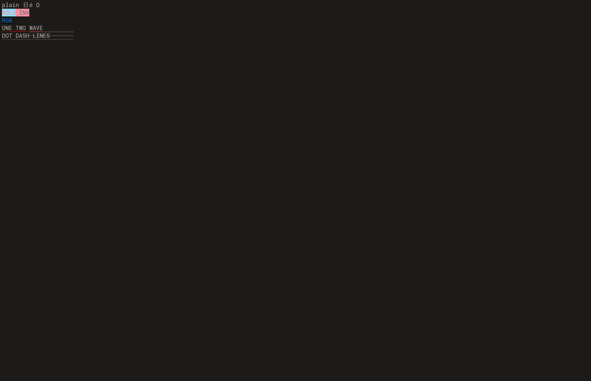

# Native terminal row rendering checkpoint

Studio now submits one C renderer-context call per pane instead of Lua text
and rectangle calls per cell. C11 immutable rows own full UTF-8 clusters,
resolved style values and wide-cell flags. The context caches visible screen
and history rows using durable content revisions; acknowledging damage does
not invalidate another renderer's cache. Deferred commands retain rows until
frame end, including frames with no changed pixels.

Rows feed the existing glyph atlas and SDL3 `SDL_RenderGeometry` quad batcher.
This does not introduce hardware instancing. Cached glyph advances/font height
extend row damage beyond cell bounds when necessary; short cells and changed
overflowing glyphs have a regression test. Font finalization now clears the Lua
owner pointer, rejects subsequent drawing and tolerates repeated finalization.
Ordinary editor commands retain their original payload size.

The exact preceding native-grid Lua renderer is saved at
`tools/termbench/reference/terminalview-native-lua.lua`, from
`f76f9679e3bff15c700b74bfebdba485ab82315d`, SHA-256
`362c7f1c3ad312978be0eefaf53d1371b72ba40e83a665384705834a2e95aee3`.
Its benchmark path is hash guarded; the separate older Lua byte-parser reference
and historical reports retain their existing meaning.

## Controlled draw measurements

macOS arm64, SDL3 3.4.14 dummy driver, 80×24 pane, normal build. Each renderer
runs in three independently warmed processes with 21 samples per case. Process
order alternates. Both use the same final C backend/renderer binary and corpus;
the reference uses the saved Lua frontend. Compiled renderer source hashes are
checked against disk before measurements. Source manifests, raw CPU/wall
samples, call counts and aggregate results are in
[`2026-10-14-native-row-raw`](2026-10-14-native-row-raw/).

These are pane draw CPU costs, including row capture and rencache replay. Feed
and `sync` occur outside the timed draw. Fonts are warmed; unchanged frames
normally skip pixel work, while changing one row exercises dirty replay. They
are not input latency, full application throughput or GPU benchmarks.

| Corpus | State | Lua reference CPU median | Native CPU median |
| --- | --- | ---: | ---: |
| Plain | Unchanged | 0.908 ms | 0.008 ms |
| Styled | Unchanged | 1.329 ms | 0.008 ms |
| Unicode | Unchanged | 0.707 ms | 0.008 ms |
| Plain | One row changes | 1.762 ms | 0.913 ms |
| Styled | One row changes | 2.278 ms | 1.119 ms |
| Unicode | One row changes | 1.821 ms | 1.204 ms |

Native draws issue zero Lua text calls, capture zero rows on unchanged frames
and one row on each dirty frame. Reference calls range from 1280–2000 per frame.
Dirty CPU reductions are approximately 48%, 51% and 34%, respectively.
The history viewport includes the reference's extra boundary row, so unchanged
plain/styled cases contain 2000 cells rather than 1920.

Reproduce with `BOGGART_STUDIO_SCRIPT=tools/termbench/studio_draw.lua`,
`SDL_VIDEODRIVER=dummy` and `BMUX_DRAW_REPORT=<output.json>`; add
`BMUX_DRAW_REFERENCE=tools/termbench/reference/terminalview-native-lua.lua` for
the reference. Use an isolated writable `BOGGART_HOME`. The comparison script
consumes `<BMUX_DRAW_PREFIX>-{native,reference}-{1,2,3}.json` and writes
`BMUX_DRAW_SUMMARY` via `boggart --eval tools/termbench/studio_draw_compare.lua`.

## Verification and remaining work

The full normal suite passed 144/144 (128.12s). Subsequent command-payload and
glyph-bound changes passed the final five affected C/Studio tests (1.65s),
including real-shell and Vim integration. The sanitizer checkpoint passed nine
tests (4.44s); final command/pixel tests passed 2/2 under ASan/UBSan (1.16s).
Strict C11 checks and `git diff --check` pass.

`studio_terminal_render` compares exact SDL backbuffer bytes with the saved
reference for colors, all underline forms, Unicode/wide cells, fractional
coordinates, clips, history, reflow, resize and alternate screens. It verifies
unchanged caching, externally acknowledged damage, glyph overflow damage,
queued source mutation/close, context finalization and font finalization.
The C tests verify snapshot OOM, immutable cluster/style lifetime, content-based
command damage, no-damage release, failed queue allocation and integer bounds.

Final real SDL3 window runs pass reference pixel parity, real shell input/final
output and Vim's exact saved text. The screenshot below comes from that window,
not the dummy benchmark.

BMUX-24 remains in progress: this checkpoint implements the native row command
and cache path over existing SDL geometry batches; its remaining atlas/style
and instancing contract still needs resolution. SGR bold/italic font variants,
shaping/procedural glyphs and font scaling belong to BMUX-25; terminal/render
Unicode-profile agreement remains open in BMUX-19. No new Python tooling was
introduced. Non-macOS execution and whole-application performance budgets are
still separate gates.
