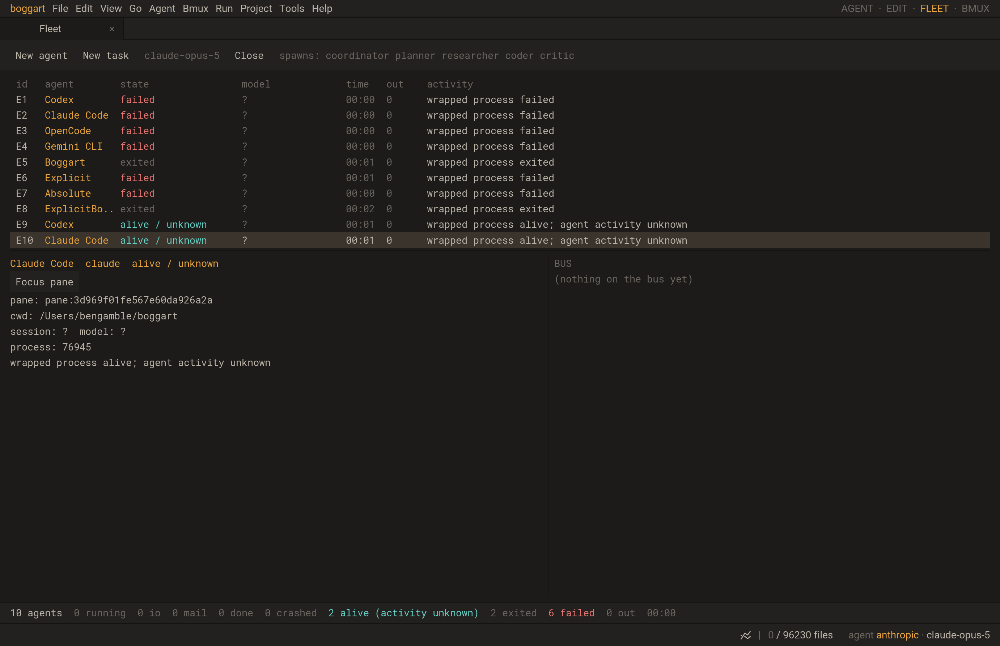

# Automatic shell registration verification

BMUX-67, 2026-10-15, macOS arm64. This adds command lifecycle registration to
the existing Fleet; it does not establish provider semantic status or approvals.

- Final serial affected regression set: **18/18 normal (10.79s)** and
  **18/18 ASan/UBSan (27.97s)**, including worker/PTY cases that previously hit
  load-related deadlines. Final new wrapper checks also pass independently:
  2/2 normal (5.50s), 2/2 sanitizer (5.46s). Logs are retained in the ignored
  build trees as `hooks-final-regression.log`.
- Normal final control/Fleet/wrapper set: 15/15, 50.01s.
- ASan/UBSan final set: 14/15, 60.84s; `studio_manual_agents` hit its 15s
  wall-clock CTest cap. Its isolated rerun passed 1/1, 14.16s. The new
  `studio_agent_hooks` passed in both sets (18.73s normal, 31.10s sanitizer).
- After the final native allocation-failure guard and shared-pane label change,
  the new two-test set passed normal 2/2 (24.53s). Sanitizer module assertions
  passed, and the full Studio assertions printed success before its 40s cap
  expired during shutdown. A direct isolated sanitizer run then completed with
  exit 0 and the full workflow success output. The new multi-launch fixture's
  outer CTest cap is now 90s; its individual readiness deadlines remain 8s.
- Actual SDL/Metal `tests/studio_agent_hooks.lua`: passed. It starts and quits
  real Boggart TUIs and runs local foreign-provider fixtures without model APIs.
- New module test initially failed because `agenthooks` was absent; implemented
  discovery/scripts/cleanup then passed. Explicit-command fixture initially hit
  a transition deadline after TUI exit. The final fixture waits for the shell's
  foreground process group before submitting the next command and retains
  registration/screen diagnostics on failure.
- Installed help profiles inspected locally: Codex CLI 0.162.1, Claude Code
  2.1.294. Only help/version commands were invoked; no provider session/API was
  started for these inspections. OpenCode/Gemini launch behavior is covered by
  local executable fixtures, not claims about an installed provider release.
  Their command profiles were cross-checked against the official
  [OpenCode CLI reference](https://docs.opencode.ai/docs/cli/) and
  [Gemini CLI cheatsheet](https://geminicli.com/docs/cli/cli-reference/).

The first simultaneous normal/sanitizer 18-test run also hit timing limits in
the existing worker and PTY tests. Normal passed 17/18; sanitizer passed 14/18.
Host load averages exceeded 230; unrelated VM/Java workloads dominated process
CPU and memory. They were left untouched. Verification then ran serially; no
existing test deadlines were loosened. The new wrapper-module process timeout
is 10s, and its application-loop Studio test has a 90s CTest cap. These runs are
correctness evidence, not valid performance baseline measurements.

The earlier 15-test set includes `fleet`, `agentbridge`, `agentcontrol`,
`fleetworkers`, `control`, `control_unix`, `manualfleet`, `terminal_environment`,
`agenthooks`, `studio_bmux`, `studio_fleet_agents`, `studio_agent_control`,
`studio_fleet_workers`, `studio_manual_agents`, `studio_agent_hooks`.
The final 18-test set also includes `worker`, `terminal_process` and
`terminal_process_shutdown`.

The native best-effort failure path executes only before a child is launched.
An actual child exit 125 remains a reported outcome; the fixture verifies it
is not retried. Invalid pane registration and a nonexistent socket both preserve
normal execution without manufacturing a Fleet registration. The explicit
wrapper keeps registration required.

