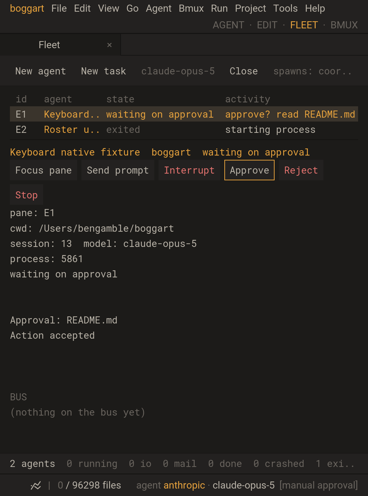

# BMUX-69 Fleet keyboard verification

2026-10-15, macOS arm64, `feature/bmux-termbench`.

Fleet uses one capability-filtered action list for pointer and keyboard.
Tab/Shift-Tab selects visible actions, Enter/Space activates, and Escape returns
to roster navigation. Focus is keyed by runtime and, for approvals, exact request
identity; it clears when the action disappears. Prompt/chooser entry retains
the existing text field and owner guards. Toolbar/detail buttons wrap at narrow
widths; clipped detail buttons cannot receive keyboard or pointer activation.
No provider protocol, execution owner or dependency was added.

## Evidence

`tests/actionfocus.lua` initially failed with the module absent, then passed
stable reorder, revocation, replacement, disabled controls and cyclic traversal.

`tests/studio_fleet_keyboard.lua` sends SDL key/text events through the actual
application loop, with a real spawned Boggart TUI and deterministic local model
fixture. It verifies:

- Keyboard New agent chooser, cancellation/return focus, Tab and Shift-Tab.
- Send prompt with pasted newline/emoji, explicit submission and restored focus
  on the same native session/process; roster append preserves selection/focus.
- Space activation before leader shortcuts, Interrupt, Reject/Approve with real
  permission requests, stale request callback rejection and no focus transfer.
- A real 520x700 window with wrapped detail actions, a visible focus border,
  full action traversal and clipped-hit bounds.
- Native worker Cancel, parent Interrupt, Focus pane, interactive TUI quit.
- Observation-only foreign capabilities, attention acknowledgement and Stop.
- In-process actor Pause/Resume/Kill; Escape returns to roster without killing,
  and roster Space still opens leader shortcuts.
- A captured old runtime callback cannot execute on a replacement generation;
  its old action focus is cleared.

No model/API calls were made. The foreign attention case uses a registry fixture
to isolate keyboard behavior; actual provider hooks are separately covered by
`tests/studio_provider_events.lua`, which is included in the regression selection.

Both normal and sanitizer builds completed with exit 0:

```sh
CCACHE_DIR=/private/tmp/boggart-bmux-ccache CCACHE_TEMPDIR=/private/tmp cmake --build build -j8
CCACHE_DIR=/private/tmp/boggart-bmux-ccache CCACHE_TEMPDIR=/private/tmp cmake --build build-asan -j8
ctest --test-dir build -R '^(fleet|studio|actionfocus|agentbridge|agentcontrol|fleetworkers|providerevents|provider_notify|agenthooks|studio_bmux|studio_fleet_agents|studio_agent_control|studio_fleet_workers|studio_manual_agents|studio_agent_hooks|studio_provider_events|studio_fleet_keyboard|studio_grapheme_edit|studio_agent_clusters)$' --output-on-failure
# Repeat with --test-dir build-asan.
```

Affected regression checkpoint: normal **19/19 passed, 20.00s**;
ASan/UBSan **19/19 passed, 22.11s**.
Logs are `build/fleet-keyboard-{build,tests}.log` and the corresponding ignored
`build-asan/` files. Earlier new-workflow checkpoints also passed normal and
sanitizer; this selection includes vertical clipping and runtime-replacement
checks added during review. After the final horizontal hit-bound check, the
focus, keyboard, native-control and provider-event tests passed again:
**4/4 normal, 16.67s; 4/4 ASan/UBSan, 24.00s**. These logs are the respective
`fleet-keyboard-final.log` files. The keyboard test checks both horizontal and
vertical bounds.

Final real SDL/Metal run exited 0:

```sh
env -u SDL_VIDEODRIVER SHELL=/bin/sh \
  HOME="$PWD/build/testhome/fleet-keyboard-metal" \
  BOGGART_HOME="$PWD/build/testhome/fleet-keyboard-metal/.boggart" \
  BMUX_RENDER_DIR="$PWD/build/testhome/fleet-keyboard-metal" \
  BOGGART_STUDIO_SCRIPT="$PWD/tests/studio_fleet_keyboard.lua" ./boggart-studio .
```

The screenshot was inspected for focus visibility, wrapped Stop and readable
approval context; the workflow tests activation as well as rendering.



Review retained capability filtering and native generation/input/request guards;
internal actions additionally capture actual actor/pending-request objects.
Menus, pending shell chords and text entry retain priority. The widget wrapping
layout helper is shared with drawing rather than introducing separate geometry.
This applies the [Ito research](../research/2026-10-15-ito-bmux.md) as design ideas;
no upstream code was copied. Anchored history, broader command palette discovery,
other provider adapters and durable server ownership remain separate work.
