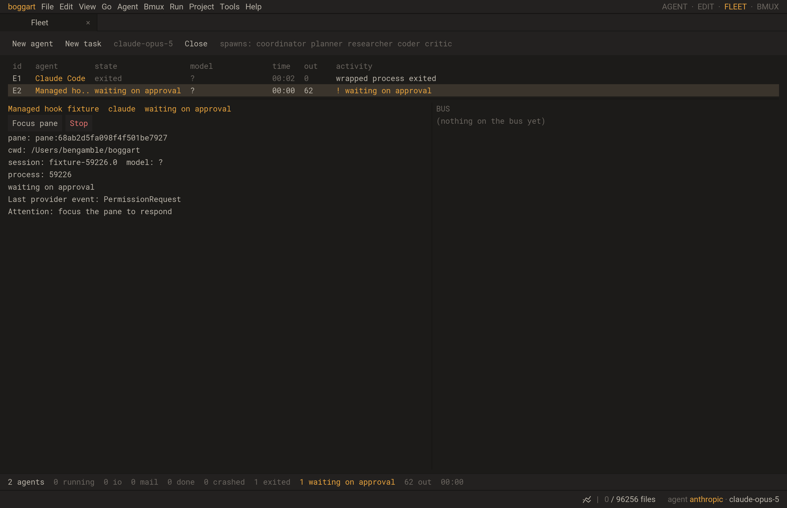

# BMUX-68 provider events verification

2026-10-15, macOS arm64, branch `feature/bmux-termbench`.

Claude launches discovered in BMUX shells and managed launches now share one
bounded event observer. A private additive Claude plugin calls the native C
`ctl notify`; Lua maps reported phases and attention into the existing Fleet.
No new runtime dependency, provider settings edits or model calls were needed.
Native process owners retain exit/stop authority. Provider event tokens cannot
heartbeat/finish the wrapper or manufacture structured approval controls.

## Verified behavior

- `tests/providerevents.lua`: ordering, root/session identity, child Stop and
  SessionStart isolation, session retirement, phase/attention mapping, cross-pane
  authentication, distinct event/process capabilities, heartbeat preservation,
  attention acknowledgement, expiry and native managed ownership.
- `tests/provider_notify.lua`: real UDS/native subprocess reporting, replacement
  of inherited reporter environment, metadata-only projection, no decision/stdout,
  late callbacks, malformed/oversized input, trailing junk/NUL and invalid identity
  types. A real wrapper heartbeat preserves reported idle until native exit.
- `tests/studio_provider_events.lua`: generated hook JSON/commands executed by
  a Lua provider fixture in the actual Studio loop, ordinary shell and New agent
  paths, one record per process, reported running/approval/question/idle states,
  visible attention, Focus acknowledgement across polling/heartbeat, child event
  isolation, no Approve/Reject/Send prompt controls for observation-only agents,
  process exit 0 and crash 7 overriding the last report, private plugin cleanup.

The fixture exercises hook dispatch and the app end to end; it does not pretend
to be an actual model/tool turn. The separate installed-provider probe below
checks actual loader compatibility.

## Commands and results

Both builds completed with exit 0:

```sh
CCACHE_DIR=/private/tmp/boggart-bmux-ccache CCACHE_TEMPDIR=/private/tmp cmake --build build -j8
CCACHE_DIR=/private/tmp/boggart-bmux-ccache CCACHE_TEMPDIR=/private/tmp cmake --build build-asan -j8
```

Final affected regression selection:

```sh
ctest --test-dir build -R '^(agentmodel|agentbridge|agentcontrol|fleetworkers|control_unix|manualfleet|terminal_environment|agenthooks|providerevents|provider_notify|terminal_process|terminal_process_shutdown|terminal_process_studio|studio_bmux|studio_fleet_agents|studio_agent_control|studio_fleet_workers|studio_manual_agents|studio_agent_hooks|studio_provider_events)$' --output-on-failure
# Repeat with --test-dir build-asan.
```

Normal **20/20 passed, 14.25s**; ASan/UBSan (`address,undefined`)
**20/20 passed, 21.39s**. Logs: ignored build directories' respective
`provider-events-build.log` and `provider-events-tests.log`. The first new Studio
fixture run failed because its setup lacked `core.project_dir`; correcting the
fixture fixed it. No production fix or timeout increase masked that failure.
An earlier complete normal checkpoint passed 20/20 in 14.90s.

Real SDL/Metal workflow, exit 0:

```sh
env -u SDL_VIDEODRIVER SHELL=/bin/sh \
  HOME="$PWD/build/testhome/provider-events-metal" \
  BOGGART_HOME="$PWD/build/testhome/provider-events-metal/.boggart" \
  BMUX_RENDER_DIR="$PWD/build/testhome/provider-events-metal" \
  BOGGART_STUDIO_SCRIPT="$PWD/tests/studio_provider_events.lua" ./boggart-studio .
```

The rendered Fleet shows the selected foreign agent waiting for approval, its
last provider event and attention instruction, with Focus/Stop controls. The
fixture verifies the actions as well as capturing the image. This run preceded
only the final native malformed-input rejection changes; those passed the full
normal/sanitizer selection afterward.



Installed **Claude Code 2.1.294** loader probe, exit 0:

```sh
BMUX_CLAUDE_PROBE=/opt/homebrew/bin/claude \
  BOGGART_HOME=/private/tmp/bmux-claude-probe-home \
  ./boggart --eval tests/provider_claude_loader.lua
```

It uses fresh private HOME, project and CLAUDE_CONFIG_DIR paths, no settings
sources or inherited API/token environment, and `--init-only`. Actual provider
events **Setup, SessionStart, SessionEnd** reached Fleet through the native
wrapper and generated hook command. A second fixture plugin's Setup hook also
executed and its file contents stayed unchanged. The isolated provider artifacts
are retained under the printed `/tmp/bmux-claude-loader-*` path for inspection;
the generated wrapper/plugins are cleaned. This proves loading/coexistence,
not full tool/approval behavior against a remote model.

Existing Ghostty attribution verifier also passed: pinned revision
`05dcf887ef51ea27821f20979493306ec3a19149`, 44 modules, 34 ported files.

## Source grounding and remaining work

Claude command hooks receive JSON on stdin. The implementation returns no
decision output and always exits zero; its configured hook timeout is 3 seconds.
Session lifecycle, turn failure, notifications and subagent identity follow the
[official hook reference](https://code.claude.com/docs/en/hooks). The plugin uses
the documented default `hooks/hooks.json` alongside a manifest and repeatable
`--plugin-dir` arguments; see the [plugin reference](https://code.claude.com/docs/en/plugins-reference).
Installed CLI help and the actual loader probe corroborate that integration.

Codex also supports lifecycle/plugin hooks, but non-managed definitions require
review/trust of their exact hash, including plugin-bundled hooks. Its integration
must retain that native review flow rather than bypass trust or overwrite legacy
notify configuration; see [official Codex hooks](https://developers.openai.com/codex/hooks).
Codex/OpenCode/Gemini semantic adapters, foreign subagent Fleet records and real
approval/prompt protocols remain follow-ups under BMUX-47. Observations can be
missing/delayed or disabled by provider policy. Fleet labels the last event;
SessionEnd alone does not establish native process completion.

BMUX-36's full-control latency target, BMUX-39's broader CLI/completion and durable
server/reconnect ownership remain open. These tests establish provider event
correctness; they make no new terminal/control latency claim.
