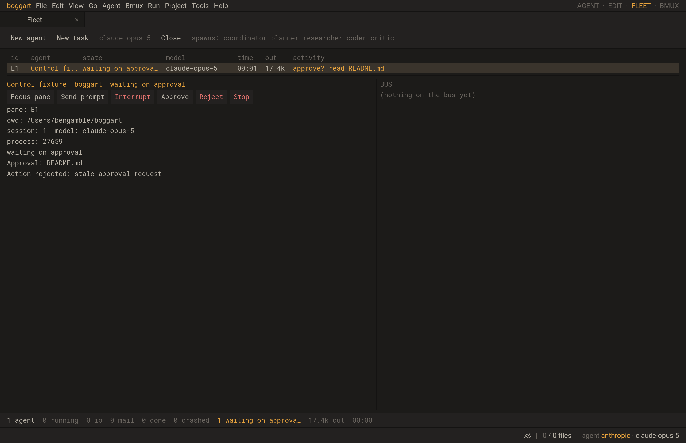

# Boggart TUI control channel

Studio launches Boggart with one inherited socket endpoint, separate from its
PTY. `terminal.open{control=true}` creates a Unix socketpair and retains the
parent endpoint in a rooted userdata returned by `terminal:channel()`.
`bpty_open` preserves only the designated descriptor and the exec-error pipe.
Other process launches strip the bootstrap environment variable. This is a
local inherited capability, with no public socket path or TCP listener.

The child calls `agent_channel.adopt_env()` once. It removes
`BOGGART_AGENT_CHANNEL_FD`, verifies a stream socket and restores CLOEXEC so
executed tools do not inherit the endpoint. On unsupported Windows PTY builds,
channel creation returns ENOSYS; this does not implement ConPTY.

`src/bchannel.c` owns native framing and I/O; `src/lchannel.c` exposes
`send(bytes)`, `receive()`, `state()` and idempotent `close()`. Frames have a
four-byte big-endian payload length. Empty frames and lengths over 64KiB close
the receiver with EMSGSIZE. Each direction admits at most 128 frames/1MiB;
send overflow rejects the whole frame, receive overflow closes the channel.
Callbacks process at most 256KiB and never enter Lua. Completed frames remain
available after EOF; an incomplete frame reports EPROTO. Polling stops before
the descriptor closes, as required by [libuv's poll contract](https://docs.libuv.org/en/v1.x/poll.html).
Both entrypoints retire channel handles before luv destroys its loop.

Messages use JSON version `v=1`. The host first sends `bind` with an opaque
Fleet `id` and `generation`; a channel binds once. The TUI's `state` includes a
monotonic sequence, actual session ID/model, phase, draft byte count/revision,
supported actions and the current approval request. Draft contents and model
stream text are not copied into Fleet metadata. `lua/agentcontrol.lua` validates
the host side; `lua/tui/agentbridge.lua` owns the TUI policy.

A `command` supplies the bound ID/generation, a command ID and a strictly
increasing integer `command_seq`. Repeated or out-of-order sequences do not
execute. A `result` acknowledges acceptance or the rejection reason. Host
outstanding commands are capped at 32; there is no automatic retry/outbox.
Acceptance means the command entered the existing control path, not that a
model turn or tool has completed.

The TUI polls commands after buffered keyboard input drains. A prompt must
match the current draft revision, find an empty draft and no owned dialog,
help/voice input or queued idle prompt. It starts `run_turn` on the existing
coordinator, or appends literal steering text to that session's bounded inbox
(32 messages/256KiB). Slash and shell syntax in a structured prompt remains
literal model input. Interrupt uses the existing turn-cancellation path.
Approve/reject checks the current request's runtime-local identity before
setting its existing decision field. It does not widen the permission policy.

`core.fleetagents` combines native process status with semantic state. Exit
still comes from the native PTY. A lost/malformed channel removes semantic
capabilities and reports unknown activity while retaining focus/stop. The
existing Fleet also keeps foreign/custom processes whose adapters only know
process liveness.

Verification is in `tests/c/agent_channel.c`, `tests/agentbridge.lua`,
`tests/studio_agent_control.lua` and the normal launcher test. The Studio test
launches the actual TUI/session/scheduler/permission gate with local model
fixtures; it never calls a model API. It exercises keyboard draft contention,
stale revisions/generations/request IDs, steering, interrupt, approval and the
visible Fleet controls. Persistent server ownership, manual-shell registration,
child-worker mirroring, durable reconnect and foreign structured adapters are
not supplied by this channel.

The full normal checkpoint passed 162/162 tests (225.31s); the expanded focused
normal run passed 18/18 (23.10s). Sanitizer checks passed 17/17 before the final
host failure guard. A regression then demonstrated that a failed protocol could
consume a later buffered state and republish capabilities. Failed hosts now
remain failed. The final bridge/host/launcher/real-TUI checks pass 4/4 normal
(2.26s) and ASAN/UBSAN. C11/Werror, attribution and diff checks pass.
Real SDL/Metal tests exercise the visible controls and channel-loss teardown.
No new Python implementation was added.

