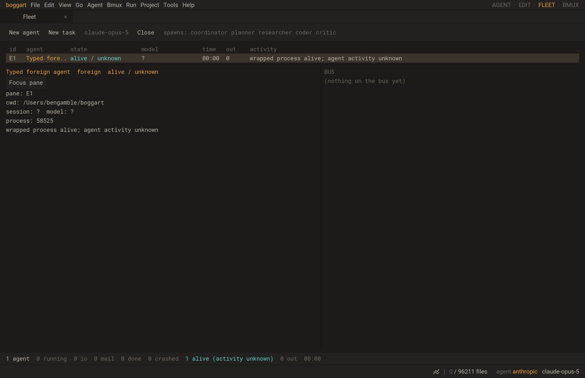

# Agents started in a BMUX shell

Open **BMUX**, then run an agent through the native wrapper:

```sh
boggart ctl run --provider codex -- codex
boggart ctl run --provider claude -- claude
boggart ctl run --provider boggart -- boggart --tui
boggart ctl run --provider custom --name 'My agent' -- /path/to/agent argument
```

The command keeps terminal input/output and receives literal arguments after
`--`. It appears in the existing **Fleet** with a **Focus pane** button. Process
liveness is reported separately from unknown agent activity. Exit status and
termination signals come from the wrapper's actual child process. Ctrl-C reaches
the foreground terminal group once; the wrapper remains to report the outcome.
Use **New agent → Boggart TUI** for the existing semantic prompt, interrupt,
approval and worker controls; a manually wrapped TUI currently reports process
lifecycle only.

```sh
boggart ctl health
boggart ctl agents --offset 0 --limit 64
```

These commands return JSON. Agent listing is scoped to the current shell's pane.
`--socket PATH` before the verb selects a socket explicitly. `ctl` enters native
C before loading Lua, opening the model/session store or reading the Lua overlay.

## Registration and lifetime

Studio starts a private HTTP-over-Unix-socket registrar on the existing libuv
loop. BMUX shells receive `BOGGART_SOCKET`, `BOGGART_PANE_ID` and
`BOGGART_PANE_TOKEN`. The socket lives in a fresh private directory beneath the
data directory, with a private `/tmp` fallback for paths too long for Unix
sockets. The socket is mode 0600; the parent directory must be owned by the
current user and inaccessible to group/other users. Accepted peers must have the
same effective UID. Browser Origin headers are refused. Pane and lease secrets
are compared in C and never returned in roster listings.

Registration returns a fresh agent ID and lease. The wrapper heartbeats each
second; more than four seconds without a heartbeat changes the registration to
**unreachable**, with process outcome unknown. A paused wrapper can recover its
live lease. Finish invalidates the lease; old heartbeats cannot revive it.
Closing the pane revokes all its registrations and removes their controls.
Unconfirmed process outcomes remain unknown after retirement and can be evicted
as history under Fleet's bound. A supplied PID is metadata and grants no Stop
capability.

The native transport refuses an existing socket/file/symlink and only removes
the same socket inode it created. Native ownership survives pending callbacks;
CLI, Studio and worker interpreters close transport handles before luv destroys
their loops. `serve.listen{socket=path, body_limit=bytes, handler=fn}` also serves
the existing Lua control route table through `control.start{socket=path}`.
Studio's narrow registrar only exposes health and manual-agent routes.

`terminal.open{env={'KEY=value', ...}}` supplies bounded literal environment
overrides: at most 64 unique entries/64KiB, dense indexes and valid variable
names. The native terminal controls TERM/COLORTERM and its inherited private
agent-channel descriptor. No shell startup files are changed.

## Verification and remaining work

`tests/control_unix.lua` exercises real requests, native health, permissions,
Host/Origin/body limits, collisions/replacements, pending-write GC, process exit
and worker shutdown. `tests/manualfleet.lua` checks cross-pane/lease rejection,
expiry/recovery, terminal outcomes and bounded retirement.
`tests/terminal_environment.lua` checks literal overrides and validation.
`tests/studio_manual_agents.lua` uses the actual application loop and PTYs to
exercise typed commands, a data home unusable by Lua/store startup, literal
Unicode arguments/stdin, native paginated listing, visible Fleet focus, exit 7,
launch failure, Ctrl-C, killed wrappers and pane retirement.

The 16 focused control/worker/PTY/Fleet tests pass in normal (8.35s) and
ASan/UBSan (11.93s) builds. The final listing extension passes the Studio test
again in both builds. A real SDL/Metal run also passes the workflow.



The [latency ledger](benchmarks/2026-10-15-control-unix.json) keeps narrow and
full control routes separate: registrar median 10.125µs/p99 16.75µs versus full
policy-scoped health median 574.542µs/p99 2952.084µs. These measure 1,000 warmed
same-process libuv connection/response round trips, excluding process startup
and Studio frame scheduling. The full control route still misses the provisional
100µs target; BMUX-36/11 remain open. BMUX-39 still needs the broader hot verbs
and shell completion. Automatic provider hooks/bare-command discovery, foreign
semantic controls, and server-owned persistent/reconnectable terminals remain
separate roadmap work. Only commands launched with the wrapper are registered
by this manual-shell path.
