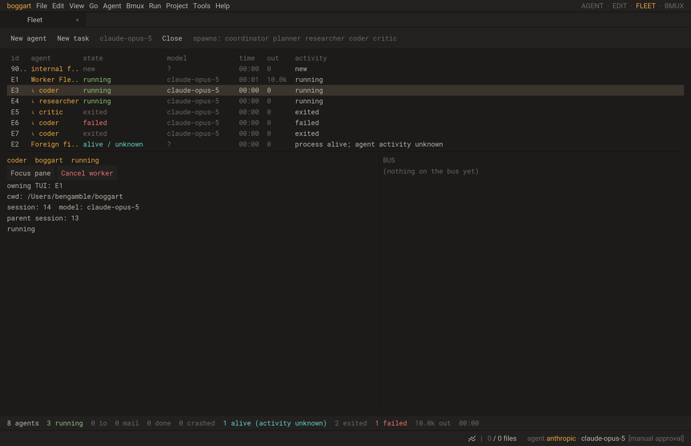

# TUI workers in the common Fleet

BMUX-65 extends the accepted agent-control design. The TUI remains the execution
owner. Scheduler start/stop events capture even short-lived agents; bounded
metadata reports travel over its existing private channel. A fresh incarnation
per start protects commands when a native session ID is reused. Live scans
reconcile current state, while recorded final outcomes distinguish completion,
failure and cancellation. Utility scheduler actors without agent records are
not agents and are excluded.

Studio registers child rows under the owning TUI in the same Fleet registry.
Native parent session metadata is retained separately. Focus opens the existing
TUI pane; Cancel worker routes through its supervisor with session/incarnation
checks. Finished history is evictable under the existing registry bound. Channel
loss disables child control and reports unknown reachability; process exit or
pane close ends outstanding workers without inventing successful completion.

Verify transient completion, failure, nested parent identity, stale/reused IDs,
cancellation and same-TUI survival, bounded history, channel loss and closure.
Use actual spawned TUI/scheduler fixtures and real Fleet clicks, plus normal and
sanitizer checks. Save and push the verified increment. Foreign manual-shell
registration and rich foreign-provider controls remain separate roadmap work.

Implemented and verified: 18 focused tests pass normally (8.44s) and under
ASAN/UBSAN (18.48s). The final abrupt-process-exit extension passes separately
in both builds. A real SDL/Metal replay passes group display, Focus/Cancel,
approval cancellation, repeated waves, channel loss and pane/process teardown.
Unit checks include 40 transient workers drained in bounded batches, live
backfill, reporting/roster capacity, incarnation reuse, numeric identity
canonicalization, history eviction and live-slot cleanup. Attribution and diff
checks pass. No remote model request or Python implementation is used.

